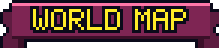
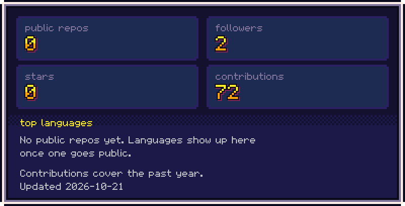
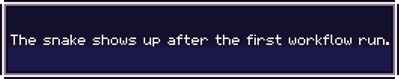

  

  <a href="https://anrlldev-bit.github.io/anrlldev-bit/play/"><b>▶ Walk around the world map</b></a>

  

  

- **[Tendril](https://tendrilapp.vercel.app)**: Android chat that works over Bluetooth, no internet needed. Kotlin, Jetpack Compose.
- **[DBLab](https://dblabapp.vercel.app)**: SQL lessons in Indonesian, with queries running in the browser. Next.js, sql.js.
- **[FileFlow](https://fileflowpc.vercel.app)**: desktop app that automates file chores. Tauri.
- **[AKARI](https://akarijapaneseclub.vercel.app)**: website for a Japanese culture club, with a meetings area. Next.js, Supabase.

  

  

  

